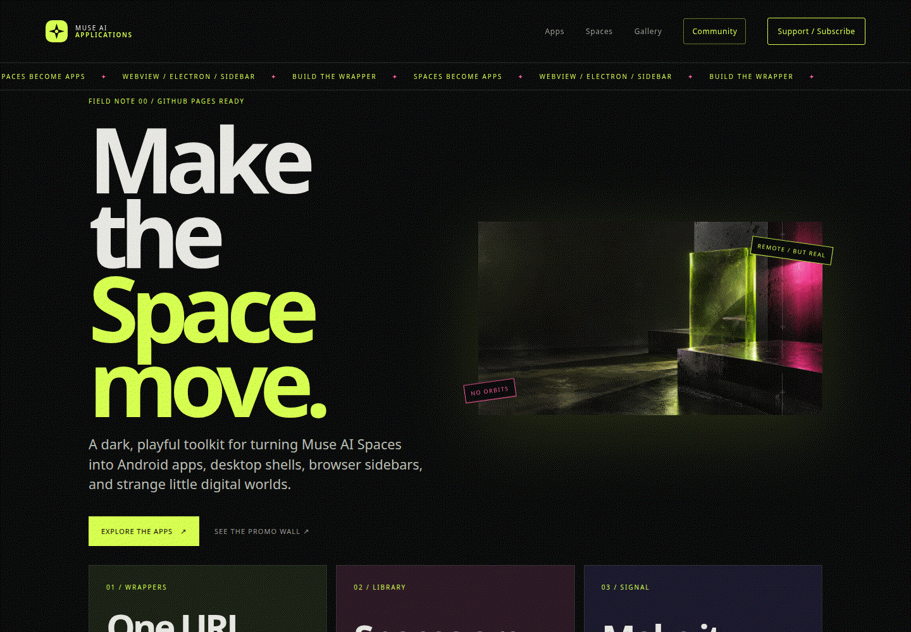
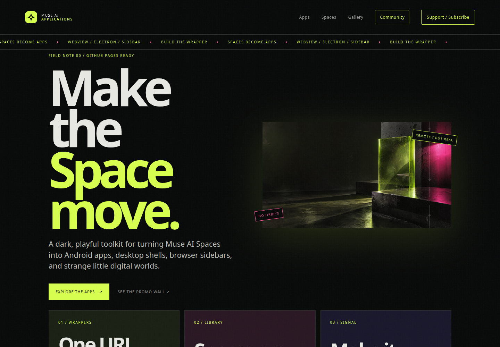
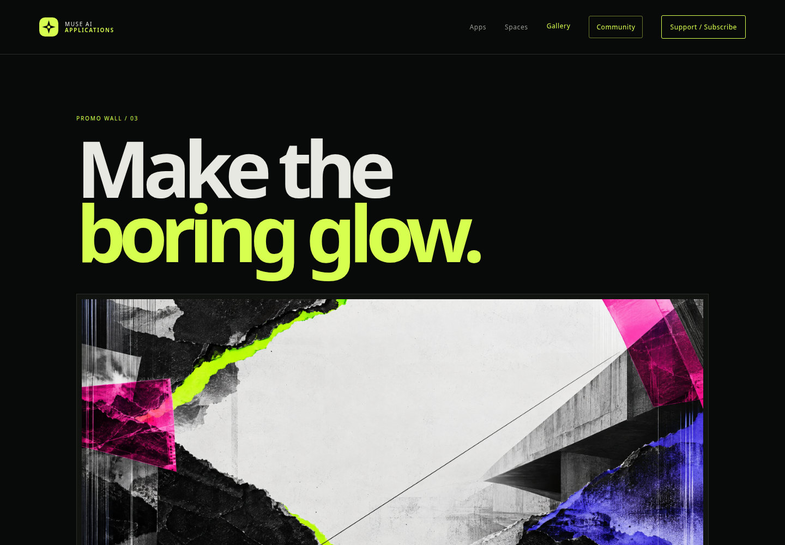
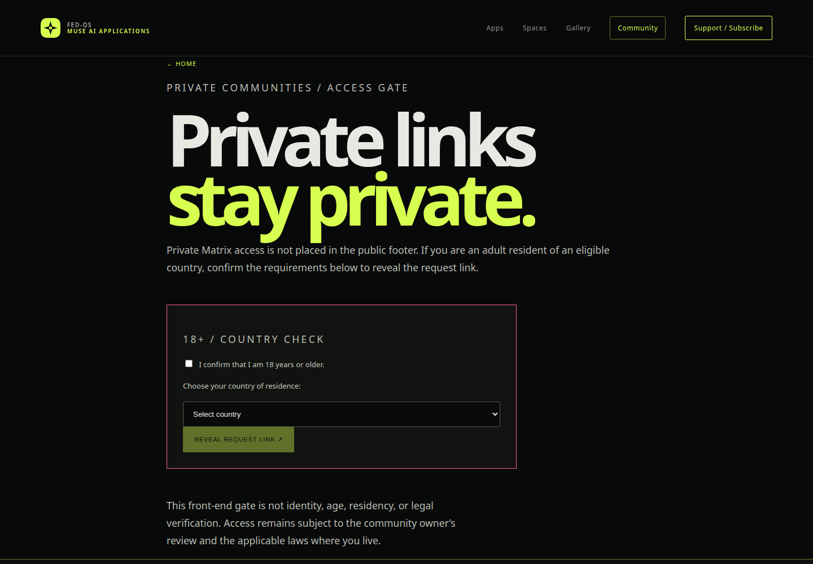
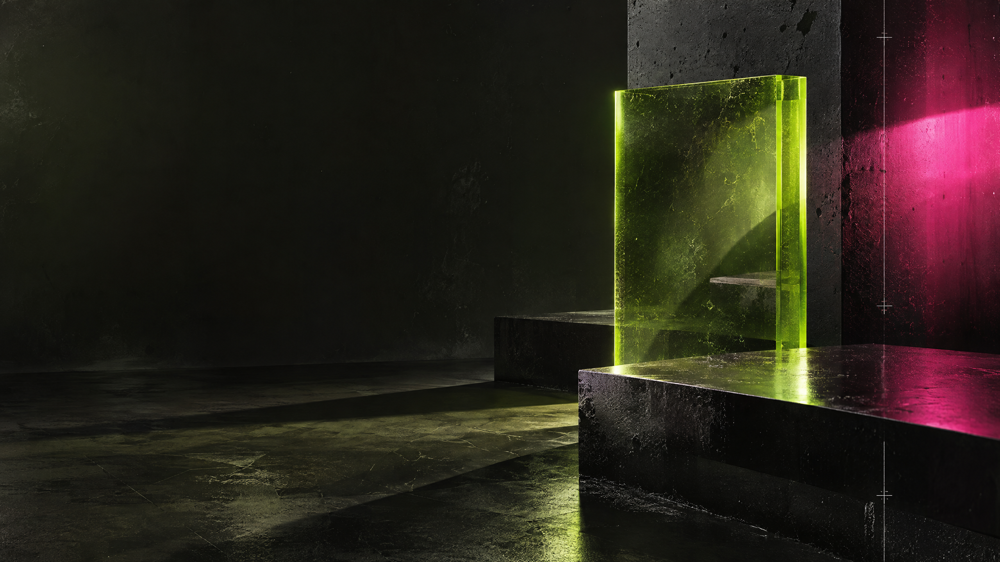
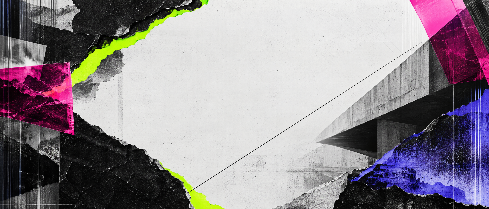
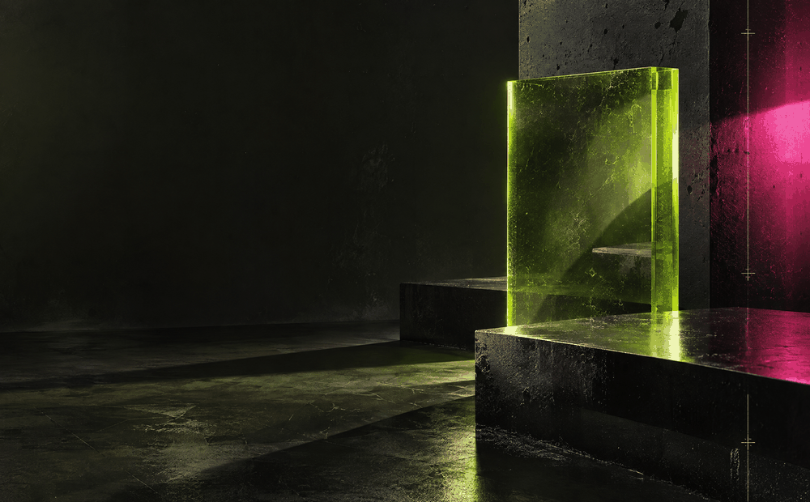

# Muse AI Applications

A documentation and starter-kit repository for turning Muse AI Spaces into Android WebView apps, Electron desktop shells, browser sidebars, and other web-to-app wrappers.

[](LICENSE) [](index.html) [](wrangler.toml)

> **30-second demo:** open [`index.html`](index.html), or run `python3 -m http.server 8765` and visit [`http://127.0.0.1:8765/index.html`](http://127.0.0.1:8765/index.html).

## Why this exists

A Muse Space can be useful in a browser and still be awkward to turn into an installable or embedded-feeling product. The hard parts are usually not the first `loadUrl()` call: they are session behavior, top-level navigation, share-link fragility, re-sharing after edits, product chrome, wrapper-specific testing, and release expectations.

This repository makes those decisions visible. It separates the hosted Space from the wrapper around it, records what has actually worked, preserves known defects and untested paths, and provides small starting points instead of pretending that a green build proves a reliable app.

The project is intentionally practical and explicit: one Space, one share URL; edit, re-share, same URL, reload; test the real URL in the target wrapper; and do not add a Cloudflare proxy when the project is meant to test the Space URL itself.

## See it work

### Run the real static site

```bash
python3 -m http.server 8765
```

Then open [`http://127.0.0.1:8765/index.html`](http://127.0.0.1:8765/index.html). The site is dependency-free at runtime and includes the animated landing page, looping ticker, symbol favicon, promotional gallery, age-gated payment page, Discord page, private-community gate, and animated FED-OS footer.

### Fastest examples

- [`index.html`](index.html) — quickest visual demo and site entry point
- [`background/index.html`](background/index.html) — standalone dark animated background
- [`gallery.html`](gallery.html) — original banners, posters, and animated signal GIF
- [`apps.html`](apps.html) — wrapper choices and starter routes
- [`invite.html`](invite.html) — FedPromptly animated community invite button and modal
- [`private-communities.html`](private-communities.html) — 18+ and country-selection gate before the private access request path
- [`payment.html`](payment.html) — age-gated payment and support area

No live demo URL is configured in this repository. The included GitHub Pages/Cloudflare Pages files are deployment configuration, not proof that a deployment is currently active.

### Real local demo recording

This GIF was captured from the running local static site rather than drawn as a mockup:



## Screenshots

These screenshots were captured from the actual local HTML pages with Chromium.

| Homepage | Promotion gallery |
|---|---|
| [](index.html) | [](gallery.html) |

| Private-community gate |
|---|
| [](private-communities.html) |

## Visual identity and created assets

The project includes original, dependency-free visual assets for the static site. They use dark architectural fields, paper and acetate texture, fluorescent seams, hard-flash contrast, and signal trails—without orbital, planetary, or ring-based visual language.







Additional poster assets are available in [`assets/`](assets/): [`promo-editorial.png`](assets/promo-editorial.png), [`promo-signal.png`](assets/promo-signal.png), [`logo-mark.svg`](assets/logo-mark.svg), and [`favicon.svg`](assets/favicon.svg).

## What is included

### Static site

- Multi-page HTML landing site with animated CSS effects and responsive layouts
- Symbol-based SVG favicon and reusable logo mark
- Promotional gallery with original SVG artwork and animated GIF
- `invite.html` with the supplied FedPromptly-style animated community button and modal
- `payment.html` with an age gate, PayPal subscription, Stripe card checkout, GitHub Sponsors, Buy Me a Book, and NOWPayments routes
- `discord.html` with public Discord buttons and an 18+ email-request flow that does not automatically open the restricted invite
- `private-communities.html` with an 18+ checkbox and eligible-country selection before revealing the private access request path
- Animated FED-OS footer with shortened public buttons for ecosystem, membership, storefront, Whop, contact, media, support, Discord developers, Bluesky, artwork, and advertising
- `_headers`, `_redirects`, and `wrangler.toml` for static hosting workflows

### Documentation and templates

- [`guides/web-to-apk.md`](guides/web-to-apk.md) — what web-to-APK means and where the risks are
- [`guides/android-webview.md`](guides/android-webview.md) — Kotlin WebView architecture
- [`guides/desktop-electron.md`](guides/desktop-electron.md) — Electron slots and tab behavior
- [`guides/browser-extensions.md`](guides/browser-extensions.md) — sidebar/web-extension pattern
- [`guides/space-to-app-checklist.md`](guides/space-to-app-checklist.md) — edit, re-share, same URL, reload
- [`templates/android-webview/`](templates/android-webview/) — Android starter concept
- [`templates/desktop-electron/`](templates/desktop-electron/) — minimal Electron shell
- [`templates/web2app-blueprint/`](templates/web2app-blueprint/) — APK/AAB planning blueprint
- [`case-studies/`](case-studies/) — recorded project status, including known defects and stopped efforts
- [`tests/`](tests/) — Google Sites, desktop, and dark-mode test notes
- [`spaces/library.md`](spaces/library.md) — the twelve recorded Spaces

## Quick start

### View the static site

```bash
# from the repository root
python3 -m http.server 8765
# open http://127.0.0.1:8765/index.html
```

There is no root `package.json` or required build step. The root site is plain HTML, CSS, JavaScript, SVG, and GIF assets.

### View the standalone background

```bash
# either open background/index.html directly,
# or keep the local server running and visit:
# http://127.0.0.1:8765/background/index.html
```

### Try the Electron starter

The Electron example has its own package file and is template-level code:

```bash
cd templates/desktop-electron
npm install
npm start
```

This launches the minimal local shell. It is not the finished Muse-3-Desktop application and does not claim to solve remote-session behavior.

### Run lightweight checks

```bash
node --check assets/site.js
node --check background/app.js
unzip -t ../MuseAi-Applications.zip   # when checking the packaged archive from its parent directory
```

## Important status notes

This repository is a documentation, static-site, and starter-template project. It does not contain a release APK, a finished Electron production build, or a configured live deployment URL.

The case studies preserve the source record: MuseAi-Number-5 is debug-only and was not run on a device; Muse-3-Desktop had inactive Muse 2 and Muse 1 tabs despite a green build; Muse Number Two was stopped; MuseAi-KillSwitch is a blueprint; and logged-in WebView behavior for protected Space URLs remains untested in the recorded notes.

A front-end age gate is an access-flow UI, not identity, age, residency, or legal verification. Payment providers and third-party community services process their own interactions under their own terms.

## Repository layout

```text
MuseAi-Applications/
├── index.html, apps.html, spaces.html, gallery.html
├── invite.html, payment.html, discord.html, private-communities.html
├── assets/                  # favicon, logos, original promotion art, screenshots, GIFs
├── background/              # standalone animated background demo
├── guides/                  # platform and Space-to-app guidance
├── templates/               # Android, Electron, and Web2App starters
├── case-studies/            # documented project history
├── tests/                   # recorded test results
├── tools/                   # tool and URL-limit notes
├── spaces/                  # Space library
├── _headers, _redirects     # static deployment helpers
└── wrangler.toml            # Cloudflare Pages configuration
```

## License

MIT. See [`LICENSE`](LICENSE).
